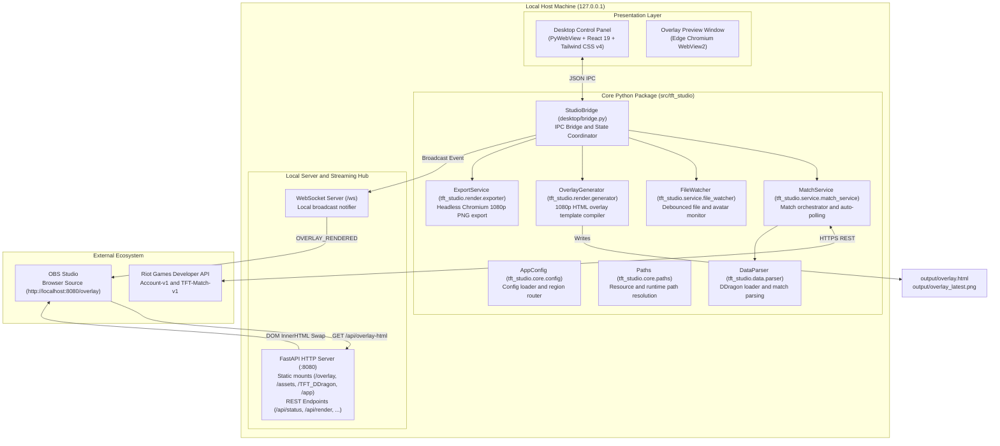

<div align="center">

# TFT Post-Match Studio

Post-match esports overlay and match tracking tool for Teamfight Tactics (TFT).

Connect to the Riot Games API, retrieve match records, and display 1080p overlays directly in OBS Studio using WebSocket-driven DOM updates without page reloads.

[](LICENSE)
[](https://v2.tauri.app/)
[](https://www.python.org/)
[](https://fastapi.tiangolo.com/)
[](https://react.dev/)
[](https://tailwindcss.com/)
[](https://vitejs.dev/)
[](https://obsproject.com/)
[](https://github.com/triphung-git/piggy)

[English](README.md) | [Tiếng Việt](README.vn.md)

</div>

---

## Table of Contents

- [Overview](#overview)
- [Key Features](#key-features)
- [System Architecture](#system-architecture)
- [Tech Stack](#tech-stack)
- [Project Structure](#project-structure)
- [Quick Start Guide](#quick-start-guide)
  - [Prerequisites](#prerequisites)
  - [Installation from Source](#installation-from-source)
  - [Portable and Installer Setup](#portable-and-installer-setup)
- [Configuration](#configuration)
  - [Environment Variables (.env)](#environment-variables-env)
  - [Overlay Configuration (overlay_config.json)](#overlay-configuration-overlay_configjson)
- [OBS Studio Integration](#obs-studio-integration)
- [REST API and WebSocket Protocol](#rest-api-and-websocket-protocol)
  - [REST Endpoints](#rest-endpoints)
  - [Authentication and Security](#authentication-and-security)
  - [WebSocket Protocol (/ws)](#websocket-protocol-ws)
- [Build and Packaging](#build-and-packaging)
  - [Automated Packaging](#automated-packaging)
  - [Manual Build Steps](#manual-build-steps)
- [Testing and Quality](#testing-and-quality)
- [Troubleshooting](#troubleshooting)
- [Contributing](#contributing)
- [Legal Disclaimer](#legal-disclaimer)
- [License](#license)

---

## Overview

TFT Post-Match Studio is an open-source overlay solution designed for esports tournament organizers, casters, and streamers.

In competitive TFT tournaments, displaying post-match lobbies, player placements, units, items, and augments manually takes time and introduces entry errors. This application automates match retrieval and presentation:
1. Pulls match records directly from the Riot Games API after game completion.
2. Resolves game identifiers (champions, traits, items, augments) using a local Data Dragon cache.
3. Pushes instant updates to OBS Studio over a local WebSocket connection using a DOM replacement mechanism that prevents screen flickering.
4. Runs locally on the host machine without external database dependencies or cloud hosting fees.

---

## Key Features

- Riot Games API integration:
  - Resolves player PUUID and downloads recent TFT match records automatically.
  - Implements a token-bucket rate limiter to avoid HTTP 429 rate limit errors.
  - Supports regional routing for SEA (VN, SG, TW, TH, PH), Asia (KR, JP), Americas (NA, BR, LAN, LAS, OCE), and Europe (EUW, EUNE, TR, RU).

- OBS Overlay (1920x1080):
  - HTML5 and CSS3 esports broadcast layout designed for 1080p canvas resolution.
  - Updates via WebSocket notification: client fetches `/api/overlay-html` and replaces container markup with a CSS opacity fade, avoiding page reloads.
  - Displays tournament headers, stage indicators, player avatars, placement badges, and trait tiers.

- Desktop Control Panel (Tauri v2 + FastAPI Sidecar):
  - Ultra-lightweight desktop shell built with Tauri v2 (Rust) managing an isolated Python FastAPI sidecar binary.
  - Multi-platform support: Windows x64, macOS (Apple Silicon arm64 & Intel x64), and Linux x64 (.AppImage & .deb).
  - Modern interface built with React 19, TypeScript, Tailwind CSS v4, and Lucide icons.
  - In-app Auto-Update with User Consent: Seamless background check via `@tauri-apps/plugin-updater` with changelog modal offering "Cập nhật ngay" (Update now) or "Để sau" (Later) to protect live broadcasts.
  - Accessible via native desktop window or via browser at `http://127.0.0.1:8080/app`.

- Augment Selector and Data Dragon localization:
  - Visual selector for Hextech Augments (Silver, Gold, Prismatic) with search functionality.
  - Local Data Dragon cache supporting active sets, champions, traits, items, and tacticians in English (en_US) and Vietnamese (vi_VN).

- PNG snapshot export:
  - Generates 1080p PNG images using Headless Chromium or Microsoft Edge for post-match social media reporting.

- Live file watcher:
  - Monitors `overlay_config.json`, `.env`, and `assets/avatars/`, triggering a re-render 0.5s after file modifications.

- Localhost security:
  - Binds strictly to `127.0.0.1:8080`. API keys and match data remain on your local machine.
  - Protected write operations requiring `X-Studio-Token` authentication.

---

## System Architecture



### Event Sequence

1. **Trigger**: User clicks **Render** in the Control Panel, an external tool sends `POST /api/render`, or FileWatcher detects configuration changes.
2. **Fetch and Parse**: `MatchService` queries Riot API (or loads local cached match data) and runs raw telemetry through `DataParser` against `TFT_DDragon` assets.
3. **Compile**: `OverlayGenerator` compiles fresh markup and writes to `output/overlay.html`.
4. **Notify**: `LocalNotifier` broadcasts an `OVERLAY_RENDERED` event to connected WebSocket clients.
5. **DOM Swap**: OBS Browser Source receives the event, fetches `/api/overlay-html`, and updates the DOM with a CSS opacity fade without reloading the browser source.

---

## Tech Stack

| Domain | Technologies | Details |
|---|---|---|
| **Backend Core** | Python 3.11+, FastAPI, Uvicorn, WebSockets | Asynchronous event loop, local HTTP server, and WebSocket hub |
| **Desktop Shell** | PyWebView 6.0+, Microsoft Edge WebView2 | Lightweight Windows desktop shell without Electron overhead |
| **Frontend UI** | React 19, TypeScript 5.7, Vite 8, Tailwind CSS v4 | High-performance desktop control panel |
| **UI Components** | Lucide React, vite-plugin-singlefile | Vector icon set and single-bundle distribution capability |
| **Game Data** | Riot Games API, Data Dragon (Set 18+) | Multi-region routing and offline asset definitions |
| **Broadcasting** | OBS Studio Browser Source, Chromium Headless | 1920x1080 60fps overlay and PNG screenshot generator |
| **Packaging** | PyInstaller 6.5+, Inno Setup 6 | Standalone folder executable bundle and Windows setup wizard |

---

## Project Structure

```text
Teamfight-Tactics_Overlay/
├── src/                            # Python application source tree
│   └── tft_studio/                 # Main tft_studio package
│       ├── api/                    # HTTP and WebSocket endpoints
│       │   └── hub.py              # FastAPI server, security middleware, and WebSocket notifier
│       ├── core/                   # Configuration and path resolution
│       │   ├── config.py           # AppConfig dataclass, region mapping, and JSON helpers
│       │   └── paths.py            # Path resolver for dev and PyInstaller environments
│       ├── data/                   # Data parsing and validation
│       │   └── parser.py           # DDragonLoader, match transformer, and augment validation
│       ├── render/                 # Overlay generation and image export
│       │   ├── generator.py        # Jinja-style HTML overlay compiler
│       │   └── exporter.py         # Headless Chromium 1080p PNG exporter
│       ├── riot/                   # Riot Games API client
│       │   └── client.py           # Thread-safe client with token-bucket rate limiter
│       └── service/                # Business services and background tasks
│           ├── match_service.py    # Match coordinator and polling thread
│           └── file_watcher.py     # Debounced file system watcher for live hot-reload
├── desktop/                        # Desktop application entrypoint
│   ├── app.py                      # PyWebView window manager (Control Panel and Preview)
│   └── bridge.py                   # Bidirectional IPC bridge between Python and React
├── Web Overlay/                    # Frontend React control panel
│   ├── src/
│   │   ├── components/             # React UI components (SourceTransformPanel, etc.)
│   │   ├── App.tsx                 # Root application component
│   │   ├── index.css               # Tailwind CSS v4 imports
│   │   └── main.tsx                # React DOM entrypoint
│   ├── package.json                # Node.js dependencies and scripts
│   ├── tsconfig.json               # TypeScript compiler configuration
│   └── vite.config.ts              # Vite 8 build pipeline with Tailwind v4
├── templates/                      # Overlay templates
│   ├── overlay.html                # Base overlay HTML markup
│   └── overlay.css                 # 1080p layout and animation stylesheets
├── assets/                         # Graphic assets and typography
│   ├── League_Spartan/             # Bundled font family
│   ├── avatars/                    # Custom player portrait overrides
│   ├── app_icon.ico                # Application executable icon
│   └── background.png              # Default 1080p tournament backdrop
├── TFT_DDragon/                    # Riot Data Dragon game assets (offline cache)
│   ├── data/                       # Multilingual definitions (vi_VN, en_US)
│   └── img/                        # Champions, traits, items, augments, tacticians
├── output/                         # Generated artifacts (overlay.html, PNG snapshots, cache)
├── tests/                          # Automated test suite
│   ├── unit/                       # Unit tests (bridge, config, parser, generator, riot client)
│   ├── security/                   # Security tests (input validation, network isolation)
│   ├── fixtures/                   # Sample match payloads and mock responses
│   └── golden/                     # Golden master HTML and CSS references
├── pyproject.toml                  # Python package configuration and tool settings (Ruff, Pytest)
├── requirements.txt                # Python runtime dependencies
├── studio.spec                     # PyInstaller build specification
├── installer.iss                   # Inno Setup 6 compilation script for Windows installer
├── build_exe.bat / build_exe.ps1   # Packaging scripts
├── run_app.bat / run_app.ps1       # Launch scripts
├── create_desktop_shortcut.ps1     # Windows desktop shortcut generator
├── overlay_config.json             # Tournament branding and augment overrides
└── .env.example                    # Environment template for Riot API credentials
```

---

## Quick Start Guide

### Download Pre-built Installers (Recommended)

Get the latest release for your operating system from the [GitHub Releases](https://github.com/triphung-git/piggy/releases/latest) page:

- **Windows x64**: Download `TFT.Post-Match.Studio_x64-setup.exe` (NSIS Installer) or portable `.msi`.
- **macOS (Apple Silicon - M1/M2/M3/M4)**: Download `TFT.Post-Match.Studio_aarch64.dmg`.
- **macOS (Intel)**: Download `TFT.Post-Match.Studio_x64.dmg`.
- **Linux x64**: Download `TFT.Post-Match.Studio_amd64.AppImage` (or `.deb`). Run `chmod +x` before launching.

*All releases include automatic update checking with user consent verification.*

---

### Prerequisites (For Developers Building from Source)

- **OS**: Windows 10/11, macOS 12+, or Ubuntu 22.04+ (x64 / arm64).
- **Python**: Version 3.11 or higher ([python.org](https://www.python.org/downloads/)).
- **Node.js**: Version 20 or higher ([nodejs.org](https://nodejs.org/)).
- **Rust**: Stable Rust toolchain ([rustup.rs](https://rustup.rs/)).
- **OBS Studio**: Version 28 or higher ([obsproject.com](https://obsproject.com/)).

---

### Installation from Source

#### 1. Clone the repository
```bash
git clone https://github.com/triphung-git/Teamfight-Tactics_Overlay.git
cd Teamfight-Tactics_Overlay
```

#### 2. Set up Python virtual environment
```bash
python -m venv .venv
# Activate on Windows
.venv\Scripts\activate
# Install runtime dependencies
pip install -r requirements.txt
```

#### 3. Build the Frontend UI
```bash
cd "Web Overlay"
npm install
npm run build
cd ..
```

#### 4. Configure credentials
```bash
copy .env.example .env
```
Open `.env` and set your Riot API Key and Riot ID:
```env
RIOT_API_KEY=RGAPI-xxxxxxxx-xxxx-xxxx-xxxx-xxxxxxxxxxxx
RIOT_ID=YourName#TAG
REGION=VN
```

#### 5. Launch the application
```bash
python -m desktop.app
```
Alternatively, execute the launch script:
```bash
run_app.bat
# or in PowerShell:
.\run_app.ps1
```

---

### Portable and Installer Setup

If you build or download a packaged release:
1. Run `dist_setup/TFT_Studio_Setup.exe` to install, or extract the portable folder from `dist/TFT_PostMatch_Studio/`.
2. Launch `TFT_PostMatch_Studio.exe`.
3. Open the Control Panel, input your Riot API Key directly into the UI, and start rendering.

---

## Configuration

### Environment Variables (`.env`)

| Variable | Type | Default | Description | Example |
|---|---|---|---|---|
| `RIOT_API_KEY` | `string` | *(required)* | API Key from [Riot Developer Portal](https://developer.riotgames.com). | `RGAPI-ab12-cd34-...` |
| `RIOT_ID` | `string` | *(required)* | In-game player identity in `GameName#TagLine` format. | `Faker#KR1` |
| `REGION` | `string` | `VN` | Platform and regional routing code. | `VN`, `KR`, `NA`, `EUW` |
| `MATCH_COUNT` | `integer` | `5` | Number of recent matches to fetch (1-20). | `5` |
| `LANGUAGE` | `string` | `vi_VN` | Data Dragon translation dictionary for items and traits. | `vi_VN` or `en_US` |
| `OUTPUT_DIR` | `string` | `output` | Directory where HTML and PNG artifacts are saved. | `output` |

> Note on Riot Development API Keys:
> Personal Development Keys expire every 24 hours. When expired, generate a new key on the [Riot Developer Dashboard](https://developer.riotgames.com/) and update it in the Control Panel or `.env`.

---

### Overlay Configuration (`overlay_config.json`)

```json
{
  "tournament_title": "HOSC 2026 | TEAMFIGHT TACTICS",
  "stage_title": "BRACKET STAGE",
  "game_title": "GRAND FINALS",
  "server_port": 8080,
  "background_image": "assets/background.png",
  "font_family": "League Spartan",
  "player_avatars": {
    "PlayerOne#VN2": "assets/avatars/player_one.png"
  },
  "custom_augments": [
    "GoldenDestiny_II.png",
    "A-Magical-Roll-II.png",
    "GoldenTicket3.png"
  ]
}
```

- `tournament_title`: Main title displayed on the upper broadcast banner.
- `stage_title`: Sub-banner description (for example: Group Stage, Quarterfinals, Finals).
- `player_avatars`: Maps player summoner names or Riot IDs to image files in `assets/avatars/`. If unassigned, the system displays the player's in-game Little Legend.
- `custom_augments`: Array of augment image filenames. When populated, overrides match augment data. Set to an empty array `[]` to use actual match telemetry.

---

## OBS Studio Integration

Follow these steps to add the overlay to your streaming scenes:

1. Launch OBS Studio.
2. Under Sources, click Add Source (+) and select Browser.
3. Configure settings:
   - URL: `http://localhost:8080/overlay`
   - Width: `1920`
   - Height: `1080`
   - FPS: `60` (or `30`)
   - Check **Shutdown source when not visible**
   - Check **Refresh browser when scene becomes active**
4. Click OK.
5. When you click **Render** in the desktop Control Panel, OBS automatically updates the scoreboard without full page reloads.

```text
+-------------------------------------------------------------------+
|  OBS Studio Canvas (1920x1080)                                    |
|                                                                   |
|   +-----------------------------------------------------------+   |
|   |  TOURNAMENT BANNER: HOSC 2026 | BRACKET STAGE             |   |
|   +-----------------------------------------------------------+   |
|                                                                   |
|   [Top 1] Player A  ★3 Unit [Item][Item][Item]  Augments: [A][B][C] |
|   [Top 2] Player B  ★2 Unit [Item][Item]        Augments: [A][B][C] |
|   [Top 3] Player C  ★2 Unit [Item][Item][Item]  Augments: [A][B][C] |
|   ...                                                             |
|   [Top 8] Player H  ★1 Unit [Item]              Augments: [A][B][C] |
+-------------------------------------------------------------------+
```

---

## REST API and WebSocket Protocol

When running, the server listens at `http://127.0.0.1:8080`.

### REST Endpoints

| Method | Endpoint | Description |
|---|---|---|
| `GET` | `/api/status` | Returns server status, operating mode, and client URLs. |
| `GET` | `/api/state` | Returns application state including cached matches, active player, and config. |
| `POST` | `/api/render` | Triggers overlay compilation and broadcasts update event. Requires `X-Studio-Token`. |
| `GET` | `/api/config` | Reads current `overlay_config.json`. |
| `POST` | `/api/config` | Updates overlay configuration and notifies clients. Requires `X-Studio-Token`. |
| `GET` | `/api/riot` | Returns masked Riot ID and API key validation status. |
| `POST` | `/api/riot/fetch` | Queries Riot API for recent matches of active player. Requires `X-Studio-Token`. |
| `GET` | `/api/augments` | Returns list of Hextech Augments from Data Dragon. |
| `POST` | `/api/augments` | Saves custom augment overrides and recompiles overlay. Requires `X-Studio-Token`. |
| `GET` | `/api/overlay-html` | Returns inner HTML body content of `overlay.html` for DOM replacement. |
| `GET` | `/overlay` | Main overlay endpoint loaded by OBS Browser Source. |
| `GET` | `/overlay.css` | Serves compiled CSS stylesheet. |
| `GET` | `/overlay_latest.png` | Serves latest 1080p rendered PNG snapshot. |
| `GET` | `/app` | Serves the web-based Control Panel interface in a standard browser. |

### Authentication and Security

- Mutating HTTP methods (`POST`, `PUT`, `DELETE`, `PATCH`) require the `X-Studio-Token` header. The token is generated randomly on application boot to prevent unauthorized local requests.
- Requests with non-localhost `Host` or `Origin` headers are blocked by the security middleware with HTTP 403 Forbidden.
- CORS policy restricts cross-origin access strictly to `localhost` and `127.0.0.1`.

### WebSocket Protocol (`/ws`)

Connect to `ws://127.0.0.1:8080/ws` to receive push events:
- `INITIAL_STATE`: Sent upon connection with current configurations.
- `OVERLAY_RENDERED`: Sent when an overlay renders. Payload includes `{ "match_id": "...", "timestamp": ... }`.
- `CONFIG_CHANGED`: Sent when `overlay_config.json` updates.
- `PING`: Keepalive message sent every 30 seconds of inactivity.

---

## Build and Packaging

### 1. Build the Python Sidecar

The Python FastAPI backend is compiled into a standalone binary (`tft-backend-<target-triple>[.exe]`) located in `src-tauri/binaries/`:

```bash
# Automatically detects current host architecture, generates app icons, and compiles onefile binary
python scripts/build_sidecar.py
```

### 2. Build the Desktop Application (Tauri v2)

```bash
# 1. Build the React frontend
cd "Web Overlay"
npm install
npm run build
cd ..

# 2. Build the desktop installer for your current platform
npx tauri build
```
The output installers will be located in `src-tauri/target/release/bundle/`:
- **Windows**: `.msi` and `setup.exe` (NSIS)
- **macOS**: `.dmg` and `.app`
- **Linux**: `.AppImage` and `.deb`

---

### 3. Tauri Updater Signing Keys & GitHub Releases

Tauri v2 automatically verifies cryptographic signatures before applying any in-app updates.

#### Generating Signing Keys
Run the Tauri CLI signer tool to generate a new key pair:
```bash
npx tauri signer generate -w ~/.tauri/piggy-v1.0.5.key
```
This generates:
1. **Private Key**: Saved to `~/.tauri/piggy-v1.0.5.key`.
2. **Public Key**: Displayed in console output. Copy this public key into `src-tauri/tauri.conf.json` under `plugins.updater.pubkey`.

#### Configuring GitHub Repository Secrets
To enable automated cross-platform builds and signed releases via GitHub Actions, add these repository secrets:
- `TAURI_SIGNING_PRIVATE_KEY`: The full contents of your `~/.tauri/piggy-v1.0.5.key`.
- `TAURI_SIGNING_PRIVATE_KEY_PASSWORD`: The password chosen when creating the key (or empty if unencrypted).

Store these as repository secrets (or organization secrets available to this repository). The build jobs do not use the `release-production` environment; secrets stored only there are unavailable for signing. Preserve the private key contents exactly, without extra quotes or another base64 encoding layer, and use the matching password. Keep the existing keypair when correcting secrets so installed clients can continue verifying updates.

Before CI and native builds, Release signs a disposable file with the locked Tauri CLI and verifies its signature against the public key from the release commit. A malformed key, wrong password or mismatched keypair blocks the release early. To run the same check locally with the two variables loaded securely and Minisign installed:

```bash
npm ci
python scripts/release_tools.py signing-probe --ref HEAD
```

#### Releasing a New Version
Push a semantic version tag to trigger the multi-platform release pipeline:
```bash
git tag v1.0.1
git push origin v1.0.1
```
The `.github/workflows/release.yml` GitHub Actions workflow will:
1. Validate the tag, versions and signing configuration, then run CI on the exact release commit.
2. Build and smoke-test native sidecars across Windows x64, macOS Apple Silicon (arm64), and Linux x64, then upload signed installers to a draft release.
3. Verify all updater signatures, generate `latest.json` and `SHA256SUMS`, then publish through the `release-production` gate.

Windows CI also smoke-tests the packaged sidecar. Smoke success includes graceful shutdown and temporary profile cleanup; sanitized diagnostics are uploaded when a check fails. After a code fix, use a new commit with matching version/tag rather than moving an existing release tag.

---

## Testing and Quality

Install development dependencies:
```bash
pip install -e ".[dev]"
```

Run unit and security tests:
```bash
# Run all tests
pytest

# Run unit tests only
pytest tests/unit

# Run security tests only
pytest tests/security

# Generate test coverage report
pytest --cov=tft_studio --cov-report=term-missing
```

Run linter and formatter:
```bash
# Check code style with Ruff
ruff check .

# Format code
ruff format .
```

---

## Troubleshooting

| Issue | Root Cause | Solution |
|---|---|---|
| Riot API 401 / 403 Forbidden | API key expired, invalid, or malformed. | Generate a new key at [developer.riotgames.com](https://developer.riotgames.com) and update it in the Control Panel or `.env`. |
| Riot API 404 Account Not Found | Game Name or TagLine is incorrect. | Use exact `GameName#TAG` format (for example: `Faker#KR1`). Verify server region. |
| Riot API 429 Rate Limit | Rate limit exceeded. | The client automatically backs off. Wait 60 seconds or decrease `MATCH_COUNT`. |
| OBS Overlay displays black or empty screen | Server not running or match not yet rendered. | Start the app, click **Render** in the Control Panel, and confirm `http://localhost:8080/overlay` opens in a web browser. |
| Control Panel window fails to open | Missing WebView2 runtime. | Install the [Microsoft Edge WebView2 Evergreen Bootstrapper](https://developer.microsoft.com/en-us/microsoft-edge/webview2/). |
| PNG export fails | Headless Chrome or Edge not found. | Install Google Chrome or Microsoft Edge in the default Program Files directory. |
| Font display fallback | Font files missing. | Verify `assets/League_Spartan/` contains the bundled `.ttf` font files. |

---

## Contributing

Contributions are welcome. To contribute:

1. Fork the repository on GitHub.
2. Create a feature branch:
   ```bash
   git checkout -b feature/your-feature-name
   ```
3. Run tests and linting before committing:
   ```bash
   pytest
   ruff check .
   ```
4. Commit changes using Conventional Commits:
   ```bash
   git commit -m "feat(render): add custom scoreboard layout option"
   ```
5. Push to GitHub and open a Pull Request explaining changes and verification steps.

---

## Legal Disclaimer

TFT Post-Match Studio is an unofficial community project and is not endorsed by, directly affiliated with, maintained, authorized, or sponsored by Riot Games, Inc.

Teamfight Tactics, League of Legends, and Riot Games are trademarks or registered trademarks of Riot Games, Inc. All game assets, artwork, champion icons, item imagery, and Data Dragon resources remain the intellectual property of Riot Games.

---

## License

Distributed under the MIT License. See [LICENSE](LICENSE) for full license text and copyright notices.

```text
Copyright (c) 2026 TFT Post-Match Studio Contributors
```
