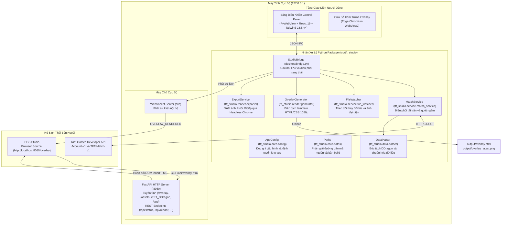

<div align="center">

# TFT Post-Match Studio

Phần mềm tạo overlay bảng xếp hạng hậu trận đấu và theo dõi trận đấu cho Đấu Trường Chân Lý (Teamfight Tactics - TFT).

Kết nối trực tiếp Riot Games API, tải dữ liệu trận đấu và hiển thị overlay độ phân giải 1080p trên OBS Studio qua kết nối WebSocket nội bộ, cập nhật trực tiếp nội dung DOM mà không cần tải lại trang.

[](LICENSE)
[](https://v2.tauri.app/)
[](https://www.python.org/)
[](https://fastapi.tiangolo.com/)
[](https://react.dev/)
[](https://tailwindcss.com/)
[](https://vitejs.dev/)
[](https://obsproject.com/)
[](https://github.com/triphung-git/piggy)

[English](README.md) | [Tiếng Việt](README.vn.md)

</div>

---

## Mục Lục

- [Tổng Quan Dự Án](#tổng-quan-dự-án)
- [Tính Năng Chính](#tính-năng-chính)
- [Kiến Trúc Hệ Thống](#kiến-trúc-hệ-thống)
- [Công Nghệ Sử Dụng](#công-nghệ-sử-dụng)
- [Cấu Trúc Thư Mục](#cấu-trúc-thư-mục)
- [Hướng Dẫn Cài Đặt Nhanh](#hướng-dẫn-cài-đặt-nhanh)
  - [Yêu Cầu Tiên Quyết](#yêu-cầu-tiên-quyết)
  - [Cài Đặt Từ Mã Nguồn](#cài-đặt-từ-mã-nguồn)
  - [Sử Dụng Bản Đóng Gói (Installer và Portable)](#sử-dụng-bản-đóng-gói-installer-và-portable)
- [Hướng Dẫn Cấu Hình](#hướng-dẫn-cấu-hình)
  - [Biến Môi Trường (.env)](#biến-môi-trường-env)
  - [Cấu Hình Overlay (overlay_config.json)](#cấu-hình-overlay-overlay_configjson)
- [Tích Hợp OBS Studio](#tích-hợp-obs-studio)
- [Giao Thức REST API và WebSocket](#giao-thức-rest-api-và-websocket)
  - [Danh Sách REST Endpoints](#danh-sách-rest-endpoints)
  - [Bảo Mật và Xác Thực](#bảo-mật-và-xác-thực)
  - [Giao Thức WebSocket (/ws)](#giao-thức-websocket-ws)
- [Đóng Gói và Xuất Bản (.exe)](#đóng-gói-và-xuất-bản-exe)
  - [Đóng Gói Tự Động](#đóng-gói-tự-động)
  - [Đóng Gói Thủ Công](#đóng-gói-thủ-công)
- [Kiểm Thử và Chất Lượng Mã Nguồn](#kiểm-thử-và-chất-lượng-mã-nguồn)
- [Xử Lý Sự Cố (Troubleshooting)](#xử-lý-sự-cố-troubleshooting)
- [Đóng Góp Phát Triển](#đóng-góp-phát-triển)
- [Tuyên Bố Miễn Trừ Bản Quyền](#tuyên-bố-miễn-trừ-bản-quyền)
- [Giấy Phép Bản Quyền](#giấy-phép-bản-quyền)

---

## Tổng Quan Dự Án

TFT Post-Match Studio là phần mềm mã nguồn mở tạo đồ họa overlay bảng xếp hạng hậu trận đấu dành cho ban tổ chức giải đấu esports, bình luận viên (caster) và streamer tựa game Đấu Trường Chân Lý (Teamfight Tactics - TFT).

Trong các giải đấu TFT, việc nhập thủ công thứ hạng 8 người chơi, tướng 3 sao, trang bị và lõi nâng cấp lên overlay phát sóng thường mất thời gian và dễ nhầm lẫn. Ứng dụng tự động hóa quy trình này:
1. Tải dữ liệu trận đấu trực tiếp từ Riot Games API sau khi trận kết thúc.
2. Dịch thuật mã định danh (tướng, tộc hệ, trang bị, lõi nâng cấp) thông qua kho Data Dragon ngoại tuyến.
3. Đẩy cập nhật trực tiếp lên OBS Studio qua kênh WebSocket nội bộ bằng cơ chế hoán đổi DOM, không reload trang và không gây đen khung hình phát sóng.
4. Chạy hoàn toàn cục bộ trên máy tính cá nhân, không yêu cầu cơ sở dữ liệu ngoài hay chi phí máy chủ đám mây.

---

## Tính Năng Chính

- Kết nối trực tiếp Riot Games API:
  - Tự động tìm PUUID và tải lịch sử trận TFT gần nhất qua Riot ID (`TênIngame#TAG`).
  - Tích hợp bộ điều tiết tần suất gọi (token-bucket rate limiter) để ngăn ngừa lỗi HTTP 429.
  - Hỗ trợ định tuyến theo máy chủ: Đông Nam Á (VN, SG, TW, TH, PH), Châu Á (KR, JP), Châu Mỹ (NA, BR, LAN, LAS, OCE), Châu Âu (EUW, EUNE, TR, RU).

- Overlay OBS độ phân giải 1080p (1920x1080):
  - Bố cục HTML5 và CSS3 thiết kế cho luồng phát sóng 1080p.
  - Cập nhật thời gian thực qua WebSocket: client nhận tín hiệu, tải `/api/overlay-html` và thay đổi nội dung hiển thị kèm hiệu ứng mờ dần (CSS fade), không cần tải lại trình duyệt.
  - Hỗ trợ tiêu đề giải đấu, vòng đấu, tên trận, ảnh đại diện tùy chọn cho từng người chơi.

- Bảng điều khiển Desktop Đa nền tảng (Tauri v2 + FastAPI Sidecar):
  - Lớp vỏ ứng dụng desktop siêu nhẹ xây dựng bằng Tauri v2 (Rust), quản lý tiến trình nền Python FastAPI độc lập.
  - Hỗ trợ đầy đủ đa nền tảng: Windows x64, macOS (Apple Silicon arm64 & Intel x64), và Linux x64 (.AppImage & .deb).
  - Giao diện xây dựng bằng React 19, TypeScript, Tailwind CSS v4 và bộ icon Lucide.
  - Tự động kiểm tra bản cập nhật với hộp thoại xin phép người dùng (User Consent Modal): hiển thị Release Notes cùng 2 nút "Cập nhật ngay" hoặc "Để sau" để không làm gián đoạn buổi phát sóng trực tiếp.
  - Có thể sử dụng trực tiếp qua cửa sổ desktop hoặc qua trình duyệt web tại `http://127.0.0.1:8080/app`.

- Bộ chọn lõi nâng cấp và hỗ trợ ngôn ngữ DDragon:
  - Giao diện chọn nhanh 3 lõi nâng cấp (Bạc, Vàng, Kim Cương) kèm thanh tìm kiếm.
  - Kho dữ liệu Data Dragon ngoại tuyến hỗ trợ các mùa giải đang kích hoạt, tướng, trang bị, tộc hệ và linh thú bằng tiếng Việt (vi_VN) và tiếng Anh (en_US).

- Xuất ảnh tĩnh PNG:
  - Tự động xuất ảnh 1080p chất lượng cao thông qua Headless Chromium hoặc Microsoft Edge để phục vụ tổng kết trận trên mạng xã hội.

- Giám sát tệp thời gian thực (File Watcher):
  - Theo dõi thay đổi của `overlay_config.json`, `.env` và ảnh đại diện trong `assets/avatars/`, tự động render lại sau 0.5 giây.

- Bảo mật cục bộ:
  - Ứng dụng chỉ lắng nghe tại `127.0.0.1:8080`. Toàn bộ dữ liệu trận đấu và khóa Riot API chỉ lưu trên máy tính của bạn.
  - Xác thực token `X-Studio-Token` đối với tất cả các yêu cầu ghi dữ liệu.

---

## Kiến Trúc Hệ Thống



### Luồng Xử Lý Sự Kiện

1. **Kích hoạt**: Người dùng bấm **Render** trong bảng điều khiển, công cụ bên ngoài gọi `POST /api/render`, hoặc FileWatcher phát hiện file cấu hình thay đổi.
2. **Tải và phân giải**: `MatchService` gọi Riot API (hoặc lấy từ cache cục bộ), chuyển dữ liệu thô qua `DataParser` đối chiếu với tài nguyên `TFT_DDragon`.
3. **Biên dịch**: `OverlayGenerator` xuất file HTML mới vào `output/overlay.html`.
4. **Phát tín hiệu**: `LocalNotifier` gửi sự kiện `OVERLAY_RENDERED` tới các client đang kết nối WebSocket.
5. **Cập nhật hiển thị**: OBS Browser Source nhận sự kiện, gọi `/api/overlay-html` và thay thế nội dung DOM trực tiếp kèm hiệu ứng mờ, không tải lại trang.

---

## Công Nghệ Sử Dụng

| Hạng mục | Công nghệ | Vai trò trong hệ thống |
|---|---|---|
| **Nhân xử lý Python** | Python 3.11+, FastAPI, Uvicorn, WebSockets | Xử lý bất đồng bộ, server HTTP và máy chủ WebSocket cục bộ |
| **Vỏ bọc Desktop** | PyWebView 6.0+, Microsoft Edge WebView2 | Ứng dụng desktop Windows nhẹ, không tiêu tốn tài nguyên như Electron |
| **Giao diện Frontend** | React 19, TypeScript 5.7, Vite 8, Tailwind CSS v4 | Bảng điều khiển Studio hiện đại |
| **Thành phần giao diện** | Lucide React, vite-plugin-singlefile | Bộ icon vector và đóng gói giao diện thành file đơn |
| **Dữ liệu Game** | Riot Games API, Data Dragon (Set 18+) | Định tuyến khu vực và tài nguyên tướng, trang bị ngoại tuyến |
| **Hiển thị phát sóng** | OBS Studio Browser Source, Chromium Headless | Trình chiếu overlay 1080p 60fps và xuất ảnh PNG 1080p |
| **Đóng gói xuất bản** | PyInstaller 6.5+, Inno Setup 6 | Biên dịch file thực thi .exe độc lập và bộ cài đặt Windows Setup |

---

## Cấu Trúc Thư Mục

```text
Teamfight-Tactics_Overlay/
├── src/                            # Mã nguồn ứng dụng Python
│   └── tft_studio/                 # Package chính tft_studio
│       ├── api/                    # Tuyến HTTP và WebSocket
│       │   └── hub.py              # Server FastAPI, middleware bảo mật và WebSocket hub
│       ├── core/                   # Quản lý cấu hình và đường dẫn
│       │   ├── config.py           # Dataclass AppConfig, ánh xạ server và hàm đọc ghi JSON
│       │   └── paths.py            # Giải quyết đường dẫn chạy dev và môi trường đóng gói .exe
│       ├── data/                   # Bóc tách và xác thực dữ liệu
│       │   └── parser.py           # DDragonLoader, phân tích trận và kiểm tra lõi nâng cấp
│       ├── render/                 # Biên dịch overlay và xuất ảnh
│       │   ├── generator.py        # Biên dịch HTML overlay theo template
│       │   └── exporter.py         # Xuất ảnh PNG 1080p qua Headless Chrome/Edge
│       ├── riot/                   # Client kết nối Riot Games API
│       │   └── client.py           # Client HTTP có rate limiter kiểu token bucket
│       └── service/                # Nghiệp vụ và tác vụ chạy ngầm
│           ├── match_service.py    # Điều phối truy vấn trận và luồng quét tự động
│           └── file_watcher.py     # Luồng giám sát tệp cấu hình để re-render tự động
├── desktop/                        # Ứng dụng Desktop PyWebView
│   ├── app.py                      # Khởi động ứng dụng, quản lý cửa sổ Control Panel và Preview
│   └── bridge.py                   # Cầu nối IPC hai chiều Python và React
├── Web Overlay/                    # Giao diện điều khiển React
│   ├── src/
│   │   ├── components/             # Thành phần giao diện React (SourceTransformPanel, ...)
│   │   ├── App.tsx                 # Giao diện chính
│   │   ├── index.css               # Định dạng Tailwind CSS v4
│   │   └── main.tsx                # Entrypoint React DOM
│   ├── package.json                # Thư viện Node.js và script build
│   ├── tsconfig.json               # Cấu hình TypeScript compiler
│   └── vite.config.ts              # Quy trình đóng gói Vite 8 với Tailwind v4
├── templates/                      # Mẫu giao diện Overlay
│   ├── overlay.html                # Khung HTML overlay
│   └── overlay.css                 # Bố cục và animation chuẩn 1080p
├── assets/                         # Tài nguyên đồ họa và font chữ
│   ├── League_Spartan/             # Bộ font chữ League Spartan đi kèm
│   ├── avatars/                    # Nơi lưu avatar tùy chọn của tuyển thủ
│   ├── app_icon.ico                # Icon ứng dụng desktop
│   └── background.png              # Hình nền 1080p mặc định
├── TFT_DDragon/                    # Dữ liệu Data Dragon ngoại tuyến
│   ├── data/                       # Dữ liệu JSON dịch thuật (vi_VN, en_US)
│   └── img/                        # Ảnh tướng, trang bị, lõi, linh thú, tộc hệ
├── output/                         # Thư mục xuất file (overlay.html, PNG, cache trận)
├── tests/                          # Bộ kiểm thử tự động
│   ├── unit/                       # Kiểm thử đơn vị (bridge, config, parser, generator, riot client)
│   ├── security/                   # Kiểm thử bảo mật (xác thực dữ liệu, phân quyền mạng)
│   ├── fixtures/                   # Dữ liệu mẫu trận đấu và phản hồi giả lập
│   └── golden/                     # File mẫu chuẩn đối chiếu (golden master)
├── pyproject.toml                  # Cấu hình package Python và công cụ (Ruff, Pytest)
├── requirements.txt                # Thư viện Python cần thiết khi chạy
├── studio.spec                     # Cấu hình đóng gói PyInstaller
├── installer.iss                   # Script tạo bộ cài Windows Setup bằng Inno Setup 6
├── build_exe.bat / build_exe.ps1   # Script đóng gói ứng dụng tự động
├── run_app.bat / run_app.ps1       # Script khởi chạy ứng dụng nhanh
├── create_desktop_shortcut.ps1     # Script tạo phím tắt trên Desktop Windows
├── overlay_config.json             # Tùy biến tiêu đề giải đấu, avatar và lõi
└── .env.example                    # Mẫu khai báo khóa Riot API
```

---

## Hướng Dẫn Cài Đặt Nhanh

### Tải Bộ Cài Đặt Sẵn (Khuyến Nghị Cho Người Dùng Cuối)

Tải phiên bản mới nhất tương ứng với hệ điều hành của bạn từ trang [GitHub Releases](https://github.com/triphung-git/piggy/releases/latest):

- **Windows x64**: Tải `TFT.Post-Match.Studio_x64-setup.exe` (bộ cài NSIS) hoặc bản di động `.msi`.
- **macOS (Apple Silicon - Chip M1/M2/M3/M4)**: Tải `TFT.Post-Match.Studio_aarch64.dmg`.
- **macOS (Intel)**: Tải `TFT.Post-Match.Studio_x64.dmg`.
- **Linux x64**: Tải `TFT.Post-Match.Studio_amd64.AppImage` (hoặc `.deb`). Cấp quyền thực thi bằng lệnh `chmod +x` trước khi mở.

*Mọi bản cài đặt đều tích hợp sẵn cơ chế kiểm tra và cập nhật tự động có xác nhận người dùng.*

---

### Yêu Cầu Tiên Quyết (Dành Cho Lập Trình Viên)

- **Hệ điều hành**: Windows 10/11, macOS 12+, hoặc Ubuntu 22.04+ (x64 / arm64).
- **Python**: Phiên bản 3.11 trở lên ([python.org](https://www.python.org/downloads/)).
- **Node.js**: Phiên bản 20 trở lên ([nodejs.org](https://nodejs.org/)).
- **Rust**: Stable Rust toolchain ([rustup.rs](https://rustup.rs/)).
- **OBS Studio**: Phiên bản 28 trở lên ([obsproject.com](https://obsproject.com/)).

---

### Cài Đặt Từ Mã Nguồn

#### 1. Tải mã nguồn dự án
```bash
git clone https://github.com/triphung-git/Teamfight-Tactics_Overlay.git
cd Teamfight-Tactics_Overlay
```

#### 2. Khởi tạo môi trường ảo Python
```bash
python -m venv .venv
# Kích hoạt trên Windows
.venv\Scripts\activate
# Cài đặt thư viện Python
pip install -r requirements.txt
```

#### 3. Biên dịch giao diện React Control Panel
```bash
cd "Web Overlay"
npm install
npm run build
cd ..
```

#### 4. Cấu hình thông tin Riot API
```bash
copy .env.example .env
```
Mở file `.env` và điền thông tin tài khoản của bạn:
```env
RIOT_API_KEY=RGAPI-xxxxxxxx-xxxx-xxxx-xxxx-xxxxxxxxxxxx
RIOT_ID=TenNguoiChoi#TAG
REGION=VN
```

#### 5. Khởi động ứng dụng
```bash
python -m desktop.app
```
Hoặc khởi chạy nhanh bằng script có sẵn:
```bash
run_app.bat
# hoặc trên PowerShell:
.\run_app.ps1
```

---

### Sử Dụng Bản Đóng Gói (Installer và Portable)

Nếu bạn tải bản phát hành đóng gói:
1. Chạy file `dist_setup/TFT_Studio_Setup.exe` để cài đặt, hoặc giải nén thư mục Portable `dist/TFT_PostMatch_Studio/`.
2. Mở file `TFT_PostMatch_Studio.exe`.
3. Nhập Riot API Key và Riot ID trực tiếp ngay trên giao diện Control Panel.

---

## Hướng Dẫn Cấu Hình

### Biến Môi Trường (`.env`)

| Biến | Kiểu | Mặc định | Ý nghĩa | Ví dụ |
|---|---|---|---|---|
| `RIOT_API_KEY` | `string` | *(bắt buộc)* | API Key lấy từ [Riot Developer Portal](https://developer.riotgames.com). | `RGAPI-ab12-cd34-...` |
| `RIOT_ID` | `string` | *(bắt buộc)* | Tên trong game dạng `Tên#TAG`. | `Faker#KR1` |
| `REGION` | `string` | `VN` | Mã máy chủ và khu vực định tuyến. | `VN`, `KR`, `NA`, `EUW` |
| `MATCH_COUNT` | `integer` | `5` | Số trận gần nhất cần tải (1-20). | `5` |
| `LANGUAGE` | `string` | `vi_VN` | Ngôn ngữ dịch thuật tên tướng, trang bị. | `vi_VN` hoặc `en_US` |
| `OUTPUT_DIR` | `string` | `output` | Thư mục lưu overlay và ảnh xuất. | `output` |

> Lưu ý về Development API Key của Riot:
> Khóa cá nhân (Development Key) của Riot sẽ hết hạn sau 24 giờ. Khi hết hạn, bạn truy cập [developer.riotgames.com](https://developer.riotgames.com/), bấm tạo lại key mới và cập nhật trực tiếp trong bảng điều khiển ứng dụng hoặc file `.env`.

---

### Cấu Hình Overlay (`overlay_config.json`)

```json
{
  "tournament_title": "HOSC 2026 | TEAMFIGHT TACTICS",
  "stage_title": "BRACKET STAGE",
  "game_title": "GRAND FINALS",
  "server_port": 8080,
  "background_image": "assets/background.png",
  "font_family": "League Spartan",
  "player_avatars": {
    "PlayerOne#VN2": "assets/avatars/player_one.png"
  },
  "custom_augments": [
    "GoldenDestiny_II.png",
    "A-Magical-Roll-II.png",
    "GoldenTicket3.png"
  ]
}
```

- `tournament_title`: Tiêu đề chính của giải đấu hiển thị ở thanh banner trên cùng.
- `stage_title`: Vòng đấu (ví dụ: Vòng Bảng, Tứ Kết, Bán Kết, Chung Kết).
- `player_avatars`: Ánh xạ tên người chơi sang file ảnh avatar tùy chỉnh trong `assets/avatars/`. Nếu không cài đặt, hệ thống hiển thị linh thú ingame của người chơi đó.
- `custom_augments`: Mảng tên file ảnh lõi nâng cấp. Nếu có dữ liệu, overlay ưu tiên hiển thị các lõi này. Nếu để mảng rỗng `[]`, hệ thống tự lấy lõi thực tế từ dữ liệu trận đấu.

---

## Tích Hợp OBS Studio

1. Mở phần mềm OBS Studio.
2. Tại bảng Sources (Nguồn), bấm nút Thêm (+) và chọn Browser (Trình duyệt).
3. Cài đặt các thông số sau:
   - URL: `http://localhost:8080/overlay`
   - Width (Rộng): `1920`
   - Height (Cao): `1080`
   - FPS: `60` (hoặc `30`)
   - Đánh dấu **Shutdown source when not visible (Tắt nguồn khi không hiển thị)**
   - Đánh dấu **Refresh browser when scene becomes active (Làm mới khi cảnh hoạt động)**
4. Bấm OK.
5. Khi bạn bấm **Render** trong bảng điều khiển, OBS tự động cập nhật bảng điểm mà không cần tải lại trang.

```text
+-------------------------------------------------------------------+
|  OBS Studio Canvas (1920x1080)                                    |
|                                                                   |
|   +-----------------------------------------------------------+   |
|   |  TOURNAMENT BANNER: HOSC 2026 | BRACKET STAGE             |   |
|   +-----------------------------------------------------------+   |
|                                                                   |
|   [Top 1] Player A  ★3 Unit [Item][Item][Item]  Augments: [A][B][C] |
|   [Top 2] Player B  ★2 Unit [Item][Item]        Augments: [A][B][C] |
|   [Top 3] Player C  ★2 Unit [Item][Item][Item]  Augments: [A][B][C] |
|   ...                                                             |
|   [Top 8] Player H  ★1 Unit [Item]              Augments: [A][B][C] |
+-------------------------------------------------------------------+
```

---

## Giao Thức REST API và WebSocket

Khi app chạy, HTTP Server cục bộ sẽ lắng nghe tại `http://127.0.0.1:8080`.

### Danh Sách REST Endpoints

| Phương thức | Endpoint | Chức năng |
|---|---|---|
| `GET` | `/api/status` | Kiểm tra trạng thái server, chế độ hoạt động và đường dẫn truy cập. |
| `GET` | `/api/state` | Lấy toàn bộ trạng thái app (cache trận, người chơi chọn, cấu hình). |
| `POST` | `/api/render` | Kích hoạt render overlay và phát sự kiện cập nhật. Yêu cầu header `X-Studio-Token`. |
| `GET` | `/api/config` | Đọc nội dung file `overlay_config.json`. |
| `POST` | `/api/config` | Cập nhật config và phát thông báo WebSocket. Yêu cầu header `X-Studio-Token`. |
| `GET` | `/api/riot` | Lấy thông tin Riot ID và trạng thái hợp lệ của khóa API. |
| `POST` | `/api/riot/fetch` | Yêu cầu tải trận đấu mới nhất của người chơi đang chọn. Yêu cầu header `X-Studio-Token`. |
| `GET` | `/api/augments` | Lấy danh sách lõi nâng cấp từ Data Dragon. |
| `POST` | `/api/augments` | Lưu 3 lõi nâng cấp tùy chỉnh và render lại overlay. Yêu cầu header `X-Studio-Token`. |
| `GET` | `/api/overlay-html` | Trả về nội dung HTML bên trong thẻ `<body>` phục vụ hoán đổi DOM. |
| `GET` | `/overlay` | Trang overlay dùng cho OBS Browser Source. |
| `GET` | `/overlay.css` | Phục vụ file CSS của overlay. |
| `GET` | `/overlay_latest.png` | Phục vụ ảnh chụp overlay độ phân giải 1080p mới nhất. |
| `GET` | `/app` | Trang web bảng điều khiển Control Panel mở trên trình duyệt độc lập. |

### Bảo Mật và Xác Thực

- Tất cả các phương thức ghi dữ liệu (`POST`, `PUT`, `DELETE`, `PATCH`) bắt buộc gửi kèm header `X-Studio-Token`. Token này được sinh ngẫu nhiên mỗi lần ứng dụng khởi động nhằm ngăn chặn truy cập trái phép từ các tiến trình khác.
- Yêu cầu HTTP có header `Host` hoặc `Origin` không thuộc `localhost` hoặc `127.0.0.1` sẽ bị middleware bảo mật chặn với mã lỗi HTTP 403 Forbidden.
- Chính sách CORS chỉ cho phép các kết nối từ `localhost` và `127.0.0.1`.

### Giao Thức WebSocket (`/ws`)

Kết nối tới `ws://127.0.0.1:8080/ws` để nhận các thông báo sự kiện:
- `INITIAL_STATE`: Trả về cấu hình ban đầu khi client vừa kết nối.
- `OVERLAY_RENDERED`: Phát ra khi overlay đã được render xong. Gói tin mang theo `{ "match_id": "...", "timestamp": ... }`.
- `CONFIG_CHANGED`: Phát ra khi `overlay_config.json` thay đổi.
- `PING`: Gói tin duy trì kết nối gửi định kỳ mỗi 30 giây khi không có hoạt động.

---

## Đóng Gói và Xuất Bản Đa Nền Tảng

### 1. Đóng Gói Python Sidecar

Mã nguồn Python FastAPI backend được biên dịch thành file nhị phân độc lập (`tft-backend-<target-triple>[.exe]`) lưu tại `src-tauri/binaries/`:

```bash
# Tự động nhận diện kiến trúc hệ điều hành, tạo bộ icon và đóng gói onefile binary
python scripts/build_sidecar.py
```

### 2. Biên Dịch Ứng Dụng Desktop (Tauri v2)

```bash
# 1. Biên dịch frontend React
cd "Web Overlay"
npm install
npm run build
cd ..

# 2. Biên dịch bộ cài đặt desktop cho hệ điều hành hiện tại
npx tauri build
```
Bộ cài đặt hoàn chỉnh sẽ nằm trong thư mục `src-tauri/target/release/bundle/`:
- **Windows**: `.msi` và `setup.exe` (NSIS)
- **macOS**: `.dmg` và `.app`
- **Linux**: `.AppImage` và `.deb`

---

### 3. Tạo Khóa Ký Số Tauri Updater & Phát Hành GitHub Releases

Tauri v2 tự động xác thực chữ ký mật mã trước khi cho phép tải và cài đặt bất kỳ bản cập nhật nào vào máy tính người dùng.

#### Tạo Cặp Khóa Ký Số
Sử dụng công cụ Tauri CLI Signer:
```bash
npx tauri signer generate -w ~/.tauri/piggy.key
```
Lệnh này sẽ tạo ra:
1. **Khóa bí mật (Private Key)**: Lưu tại `~/.tauri/piggy.key`.
2. **Khóa công khai (Public Key)**: In ra trên màn hình terminal. Sao chép chuỗi khóa công khai này dán vào trường `plugins.updater.pubkey` trong file `src-tauri/tauri.conf.json`.

#### Thiết Lập GitHub Secrets
Để GitHub Actions tự động biên dịch, ký số và phát hành đa nền tảng, thêm 2 Secret sau vào repository GitHub (Settings > Secrets and variables > Actions):
- `TAURI_SIGNING_PRIVATE_KEY`: Toàn bộ nội dung file `~/.tauri/piggy.key`.
- `TAURI_SIGNING_PRIVATE_KEY_PASSWORD`: Mật khẩu bạn đã nhập khi tạo khóa (hoặc để trống nếu không đặt mật khẩu).

Lưu hai giá trị ở repository secrets hoặc organization secrets được cấp cho repository này. Các job build không dùng environment `release-production`; secrets chỉ đặt tại environment đó sẽ không có ở bước ký. Giữ nguyên nội dung private key, không thêm dấu nháy hoặc encode base64 thêm lần nữa, và dùng đúng password tương ứng. Ưu tiên giữ keypair hiện có để các client đã cài vẫn xác minh được bản cập nhật.

Trước CI và build native, Release ký một file thử bằng Tauri CLI trong lockfile, sau đó verify với public key của commit release. Key hỏng, password sai hoặc keypair không khớp sẽ chặn release sớm. Có thể kiểm tra tương tự ở máy local sau khi nạp an toàn hai biến môi trường và cài Minisign:

```bash
npm ci
python scripts/release_tools.py signing-probe --ref HEAD
```

#### Phát Hành Phiên Bản Mới
Chỉ cần gắn thẻ Git tag theo chuẩn semantic version và đẩy lên GitHub:
```bash
git tag v1.0.1
git push origin v1.0.1
```
Quy trình tự động hóa `.github/workflows/release.yml` trên GitHub Actions sẽ:
1. Kiểm tra tag, version và cấu hình ký, sau đó chạy CI trên đúng commit release.
2. Build và smoke-test sidecar native trên Windows x64, macOS Apple Silicon (arm64) và Linux x64, rồi tải bộ cài đã ký lên draft release.
3. Verify mọi chữ ký updater, tạo `latest.json` và `SHA256SUMS`, sau đó publish qua gate `release-production`.

CI Windows cũng smoke-test bản sidecar đã đóng gói. Kết quả smoke chỉ thành công sau shutdown và cleanup profile tạm; diagnostics đã lọc thông tin nhạy cảm được tải lên khi thất bại. Khi sửa mã, dùng commit mới với version/tag tương ứng thay vì di chuyển tag release cũ.

---

## Kiểm Thử và Chất Lượng Mã Nguồn

Cài đặt các gói phụ thuộc dùng cho môi trường phát triển:
```bash
pip install -e ".[dev]"
```

Chạy toàn bộ kiểm thử đơn vị và bảo mật:
```bash
# Chạy tất cả test case
pytest

# Chỉ chạy unit test
pytest tests/unit

# Chỉ chạy security test
pytest tests/security

# Báo cáo độ phủ kiểm thử (coverage)
pytest --cov=tft_studio --cov-report=term-missing
```

Kiểm tra và định dạng mã nguồn bằng Ruff:
```bash
# Kiểm tra lỗi cú pháp và chuẩn code
ruff check .

# Tự động định dạng mã nguồn
ruff format .
```

---

## Xử Lý Sự Cố (Troubleshooting)

| Sự cố thường gặp | Nguyên nhân chính | Cách giải quyết |
|---|---|---|
| Lỗi Riot API 401 / 403 Forbidden | API Key đã hết hạn (24h), không hợp lệ hoặc sai định dạng. | Vào [developer.riotgames.com](https://developer.riotgames.com), tạo lại key mới và dán vào Control Panel hoặc `.env`. |
| Lỗi Riot API 404 Account Not Found | Sai tên người chơi hoặc Tagline. | Kiểm tra đúng định dạng `Tên#TAG` (ví dụ: `Faker#KR1`). Kiểm tra đúng khu vực `REGION`. |
| Lỗi Riot API 429 Rate Limit | Gọi API vượt tần suất cho phép của Riot. | Hệ thống tự động lùi thời gian gọi. Hãy chờ 60 giây hoặc giảm `MATCH_COUNT`. |
| OBS Overlay hiển thị trang trắng hoặc đen | Server chưa chạy hoặc chưa bấm Render. | Chạy app, bấm **Render** trong Control Panel và mở thử `http://localhost:8080/overlay` trên trình duyệt. |
| Không mở được giao diện Desktop | Thiếu thư viện Microsoft WebView2 runtime. | Cài đặt [Microsoft Edge WebView2 Bootstrapper](https://developer.microsoft.com/en-us/microsoft-edge/webview2/). |
| Xuất ảnh PNG thất bại | Không tìm thấy trình duyệt Google Chrome hoặc Edge. | Cài đặt Google Chrome hoặc Microsoft Edge ở đường dẫn mặc định trên máy. |
| Font chữ trên Overlay bị lỗi | Thiếu file font League Spartan. | Kiểm tra thư mục `assets/League_Spartan/` xem đã có đầy đủ các file `.ttf` chưa. |

---

## Đóng Góp Phát Triển

Dự án hoan nghênh các đóng góp từ cộng đồng. Quy trình gửi đóng góp:

1. Fork repository trên GitHub.
2. Tạo nhánh tính năng mới:
   ```bash
   git checkout -b feature/ten-tinh-nang
   ```
3. Chạy kiểm thử và linter trước khi tạo commit:
   ```bash
   pytest
   ruff check .
   ```
4. Commit thay đổi theo chuẩn Conventional Commits:
   ```bash
   git commit -m "feat(render): them tuy chon layout bang diem moi"
   ```
5. Đẩy nhánh lên GitHub và tạo Pull Request kèm mô tả nội dung thay đổi cùng các bước kiểm tra.

---

## Tuyên Bố Miễn Trừ Bản Quyền

TFT Post-Match Studio là dự án mã nguồn mở phi lợi nhuận do cộng đồng phát triển và không thuộc quyền sở hữu, tài trợ hay liên kết chính thức với Riot Games, Inc.

Teamfight Tactics, League of Legends và Riot Games là các thương hiệu đã được đăng ký của Riot Games, Inc. Mọi tài nguyên hình ảnh game, biểu tượng tướng, trang bị và dữ liệu Data Dragon đều thuộc quyền sở hữu trí tuệ của Riot Games.

---

## Giấy Phép Bản Quyền

Dự án được phân phối theo giấy phép mã nguồn mở MIT License. Xem chi tiết tại tệp [LICENSE](LICENSE).

```text
Copyright (c) 2026 TFT Post-Match Studio Contributors
```
