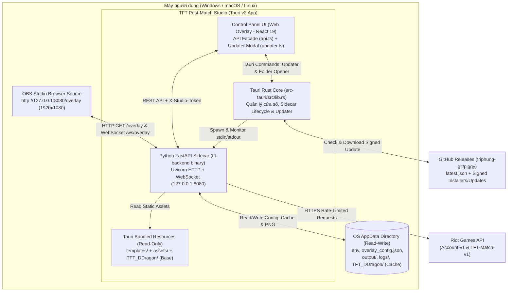
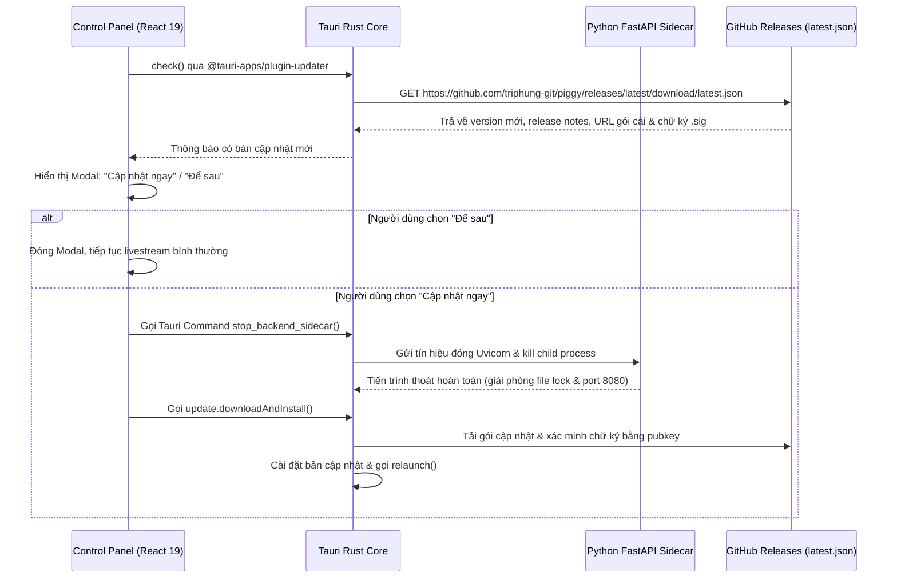

# Architecture — TFT Post-Match Studio (`piggy`): Tauri 2 + FastAPI Sidecar + Auto-Updater

> **Trạng thái:** Kiến trúc chuẩn hóa cho kho mã nguồn [triphung-git/piggy](https://www.google.com/search?q=https%3A%2F%2Fgithub.com%2Ftriphung-git%2Fpiggy)  
> **Kiến trúc:** [Tauri v2](https://www.google.com/search?q=https%3A%2F%2Fv2.tauri.app%2Fstart%2F) Desktop Shell + React 19 Control Panel (`Web Overlay/`) + Python FastAPI/WebSocket Sidecar (`src/tft_studio/`) + OBS Studio Browser Source + [Tauri Updater Plugin](https://www.google.com/search?q=https%3A%2F%2Fv2.tauri.app%2Fplugin%2Fupdater%2F) + [Tauri GitHub Actions](https://www.google.com/search?q=https%3A%2F%2Fv2.tauri.app%2Fdistribute%2Fpipelines%2Fgithub%2F)  
> **Mục tiêu nền tảng:** Windows x64, macOS (Apple Silicon `arm64` & Intel `x64`), Linux x64  
> **Chính sách cập nhật:** User-Confirmed Update (hiển thị Release Notes và chờ người dùng xác nhận trước khi tải/cài đặt)

## 1. Mục tiêu và Nguyên tắc kiến trúc

Kiến trúc này chuyển đổi dự án **TFT Post-Match Studio** ([triphung-git/piggy](https://www.google.com/search?q=https%3A%2F%2Fgithub.com%2Ftriphung-git%2Fpiggy)) từ mô hình đóng gói đơn nền tảng Windows ([pywebview](https://www.google.com/search?q=https%3A%2F%2Fpywebview.flowrl.com%2F) + [PyInstaller](https://www.google.com/search?q=https%3A%2F%2Fpyinstaller.org%2Fen%2Fstable%2F) `--onedir` + [Inno Setup](https://www.google.com/search?q=https%3A%2F%2Fjrsoftware.org%2Fisinfo.php)) sang kiến trúc Desktop đa nền tảng hiện đại, tự động cập nhật theo GitHub Releases mà không cần người dùng cài đặt bất kỳ môi trường lập trình nào.

7 nguyên tắc thiết kế cốt lõi:

1. **Giữ nguyên 100% lõi nghiệp vụ Python và luồng OBS WebSocket:** Toàn bộ logic gọi Riot Games API (`riot/client.py`), phân tích trận đấu (`data/parser.py`), biên dịch HTML (`render/generator.py`) và máy chủ FastAPI/WebSocket (`api/hub.py`) được giữ nguyên, chỉ thay đổi điểm khởi chạy sidecar và quản lý đường dẫn.
2. **Giao tiếp Hybrid (HTTP/WebSocket Localhost + Stdout Readiness):** Vì OBS Studio Browser Source là tiến trình bên ngoài bắt buộc phải kết nối vào `http://127.0.0.1:8080/overlay` và `ws://127.0.0.1:8080/ws/overlay`, hệ thống giữ nguyên máy chủ FastAPI/Uvicorn làm kênh giao tiếp chính cho cả Control Panel lẫn OBS, đồng thời dùng `stdout` của sidecar để báo tín hiệu khởi tạo thành công (`READY`) cho nhân Rust của Tauri.
3. **Quản lý vòng đời Sidecar tập trung tại tầng Rust (`src-tauri`):** Nhân Rust chịu trách nhiệm khởi chạy, giám sát và tắt tiến trình Python sidecar; tuyệt đối không khởi chạy sidecar từ mã JavaScript của Frontend để tránh lỗi nhân bản tiến trình hoặc kẹt cổng `8080` khi reload giao diện.
4. **Tách biệt tài nguyên tĩnh (`TFT_DDragon/`, `assets/`, `templates/`) khỏi binary Sidecar:** Chỉ đóng gói mã nguồn Python vào binary `--onefile` của PyInstaller; các thư mục tài nguyên tĩnh nặng được quản lý qua [Tauri Resources](https://www.google.com/search?q=https%3A%2F%2Fv2.tauri.app%2Fdevelop%2Fresources%2F) và thư mục `AppData` để ứng dụng khởi động dưới 2 giây.
5. **Dữ liệu người dùng nằm ngoài thư mục cài đặt:** Tệp `.env`, `overlay_config.json`, `output/` và `logs/` được lưu tại thư mục `AppData` chuẩn của từng hệ điều hành để tránh lỗi `PermissionError` trên macOS/Linux và không bị mất khi Auto-Update.
6. **Xuất ảnh 1080p đa nền tảng không phụ thuộc trình duyệt ngoài:** Chuyển cơ chế chụp ảnh PNG 1080p từ phụ thuộc cứng vào `chrome.exe`/`msedge.exe` sang kết xuất trực tiếp trên WebView/DOM ([html-to-image](https://www.google.com/search?q=https%3A%2F%2Fwww.npmjs.com%2Fpackage%2Fhtml-to-image)), giữ cơ chế gọi trình duyệt headless hệ thống làm phương án dự phòng.
7. **Build theo đúng kiến trúc đích (Per-Target Native Compilation):** Binary Python sidecar phải được biên dịch bằng PyInstaller trực tiếp trên runner tương ứng với từng hệ điều hành và kiến trúc CPU.

## 2. Sơ đồ kiến trúc tổng thể



## 3. Các quyết định kiến trúc (Architecture Decision Records)

### ADR-001 — Thay thế `pywebview` bằng Tauri v2 Desktop Shell
- **Quyết định:** Loại bỏ `desktop/app.py` và `desktop/bridge.py` (dùng [pywebview](https://www.google.com/search?q=https%3A%2F%2Fpywebview.flowrl.com%2F)), chuyển sang [Tauri v2](https://www.google.com/search?q=https%3A%2F%2Fv2.tauri.app%2Fstart%2F).
- **Lý do:** Tauri v2 cung cấp sẵn hệ sinh thái đóng gói đa nền tảng (NSIS `.exe`, `.dmg`, `.AppImage`), quản lý tiến trình con ([Tauri Sidecar](https://www.google.com/search?q=https%3A%2F%2Fv2.tauri.app%2Fdevelop%2Fsidecar%2F)) và cơ chế tự động cập nhật có chữ ký số ([Tauri Updater Plugin](https://www.google.com/search?q=https%3A%2F%2Fv2.tauri.app%2Fplugin%2Fupdater%2F)) với mức tiêu thụ RAM rất thấp (~40–60 MB cho phần vỏ WebView hệ thống).

### ADR-002 — Đóng gói lõi Python bằng PyInstaller `--onefile` làm Tauri Sidecar
- **Quyết định:** Biên dịch điểm vào mới `src/tft_studio/main_sidecar.py` bằng [PyInstaller](https://www.google.com/search?q=https%3A%2F%2Fpyinstaller.org%2Fen%2Fstable%2F) ở chế độ một tệp thực thi duy nhất (`--onefile`) và khai báo trong `bundle.externalBin` của `src-tauri/tauri.conf.json`.
- **Lý do:** Tauri yêu cầu mỗi external binary trong `src-tauri/binaries/` là một tệp thực thi độc lập có hậu tố target triple (ví dụ `tft-backend-x86_64-pc-windows-msvc.exe`). Để tránh thời gian giải nén lâu của `--onefile`, toàn bộ thư mục nặng (`TFT_DDragon/`, `assets/`, `templates/`) được tách ra thành `bundle.resources` của Tauri.

### ADR-003 — Giao thức Hybrid HTTP/WebSocket (`127.0.0.1:8080`) + Stdout Handshake
- **Quyết định:** Giữ nguyên máy chủ FastAPI + Uvicorn (`src/tft_studio/api/hub.py`) chạy trên `127.0.0.1:8080` (hoặc cổng cấu hình trong `overlay_config.json`) kết hợp tín hiệu khởi tạo một dòng JSON qua `stdout`.
- **Lý do:** Khác với các ứng dụng desktop nội bộ thông thường có thể chỉ dùng JSON Lines qua `stdin`/`stdout`, **TFT Post-Match Studio** bắt buộc phải phục vụ trang HTML/CSS 1080p và đẩy sự kiện WebSocket thời gian thực cho **OBS Studio Browser Source**. Việc dùng chung FastAPI/WebSocket cho cả React Control Panel (`Web Overlay/`) và OBS Studio giúp thống nhất một nguồn dữ liệu duy nhất, không phải duy trì hai giao thức song song.
- **Bảo mật Localhost:** Nhân Rust sinh một chuỗi `STUDIO_SESSION_TOKEN` ngẫu nhiên khi khởi tạo, truyền vào biến môi trường của Python sidecar và cung cấp cho React Control Panel qua Tauri Command. Các endpoint thay đổi trạng thái (`POST /api/config`, `POST /api/export`, `POST /api/shutdown`) kiểm tra header `X-Studio-Token`, trong khi các endpoint phục vụ OBS (`GET /overlay`, `WS /ws/overlay`, `GET /assets/*`, `GET /TFT_DDragon/*`) vẫn mở tự do trên loopback `127.0.0.1`.

### ADR-004 — Quản lý vòng đời Sidecar trong Rust (`src-tauri/src/lib.rs`)
- **Quyết định:** Khởi chạy và dừng sidecar trực tiếp trong mã Rust của Tauri thay vì gọi từ JavaScript frontend.
- **Lý do:** Đảm bảo chỉ có duy nhất một tiến trình `tft-backend` chạy trong suốt phiên làm việc (kể cả khi người dùng F5 reload cửa sổ UI) và đảm bảo tiến trình Python được đóng hoàn toàn trước khi [Tauri Updater Plugin](https://www.google.com/search?q=https%3A%2F%2Fv2.tauri.app%2Fplugin%2Fupdater%2F) ghi đè file thực thi trên Windows.

### ADR-005 — Phân tách `RESOURCE_DIR` (Read-Only) và `APPDATA_DIR` (Read-Write)
- **Quyết định:** Cập nhật `src/tft_studio/core/paths.py` để nhận đường dẫn từ hai biến môi trường `TFT_RESOURCE_DIR` và `TFT_APPDATA_DIR` do Tauri truyền vào.
- **Lý do:**
  - `TFT_RESOURCE_DIR` trỏ tới thư mục cài đặt chỉ đọc chứa `templates/`, `assets/` và bộ dữ liệu gốc `TFT_DDragon/`.
  - `TFT_APPDATA_DIR` trỏ tới thư mục dữ liệu người dùng của từng hệ điều hành (`%APPDATA%\com.triphung.tftstudio` trên Windows, `~/Library/Application Support/com.triphung.tftstudio` trên macOS, `~/.local/share/com.triphung.tftstudio` trên Linux), nơi lưu `.env`, `overlay_config.json`, `output/`, `logs/` và các tệp ảnh/dữ liệu người dùng tải lên.

### ADR-006 — Xuất ảnh PNG 1080p đa nền tảng không phụ thuộc Chrome ngoài
- **Quyết định:** Kết xuất ảnh chụp màn hình 1080p trực tiếp từ khung preview/overlay bằng thư viện [html-to-image](https://www.google.com/search?q=https%3A%2F%2Fwww.npmjs.com%2Fpackage%2Fhtml-to-image) (hoặc WebView ẩn 1920x1080 của Tauri) và gửi dữ liệu ảnh xuống endpoint `/api/export/save` để lưu vào `TFT_APPDATA_DIR/output/`, đồng thời cập nhật `src/tft_studio/render/exporter.py` hỗ trợ đường dẫn trình duyệt trên cả macOS/Linux như phương án dự phòng.
- **Lý do:** Loại bỏ lỗi không tìm thấy `chrome.exe` hoặc `msedge.exe` trên macOS và Linux.

## 4. Kiến trúc Runtime & Luồng hoạt động chi tiết

### 4.1 Luồng khởi động ứng dụng (Application Startup)

1. Người dùng mở **TFT Post-Match Studio**.
2. Nhân Rust (`src-tauri/src/lib.rs`) xác định đường dẫn `app_data_dir` và `resource_dir`, tạo các thư mục con (`output/`, `logs/`, `custom_assets/`) trong `app_data_dir` nếu chưa tồn tại, và sao chép `.env.example` $\rightarrow$ `.env`, `overlay_config.json` mẫu vào `app_data_dir` trong lần chạy đầu tiên.
3. Nhân Rust sinh `STUDIO_SESSION_TOKEN` và khởi chạy sidecar `binaries/tft-backend` với các biến môi trường:
   - `TFT_APPDATA_DIR`
   - `TFT_RESOURCE_DIR`
   - `STUDIO_SESSION_TOKEN`
   - `PYTHONIOENCODING=utf-8`
4. Sidecar Python (`src/tft_studio/main_sidecar.py`) khởi tạo cấu hình từ `TFT_APPDATA_DIR`, khởi chạy máy chủ FastAPI/Uvicorn trên `127.0.0.1:8080` và in ra `stdout` dòng tín hiệu:
   ```json
   {"event":"server_ready","port":8080,"status":"ok"}
   ```
5. Giao diện React 19 (`Web Overlay/`) gọi Tauri command `get_backend_connection_info()` thông qua lớp `Web Overlay/src/lib/api.ts` để lấy `baseUrl` (`http://127.0.0.1:8080`) cùng `sessionToken`, sau đó nạp cấu hình giải đấu và lịch sử trận đấu.
6. Sau khi giao diện ổn định 3 giây, module `Web Overlay/src/lib/updater.ts` gọi [Tauri Updater Plugin](https://www.google.com/search?q=https%3A%2F%2Fv2.tauri.app%2Fplugin%2Fupdater%2F) kiểm tra bản cập nhật mới ở chế độ chạy nền.

### 4.2 Thiết kế lớp Frontend API Facade (`Web Overlay/src/lib/api.ts`)

Thay thế toàn bộ các lời gọi `window.pywebview.api.*` trước đây bằng một lớp `StudioApi` duy nhất trong `Web Overlay/src/lib/api.ts`. Bảng ánh xạ chuyển đổi từ `desktop/bridge.py` sang kiến trúc mới:

| Hàm cũ trong `desktop/bridge.py` (`pywebview`) | Phương thức mới trong `Web Overlay/src/lib/api.ts` | Cơ chế thực thi |
| :--- | :--- | :--- |
| `window.pywebview.api.get_config()` | `StudioApi.getConfig()` | `GET http://127.0.0.1:8080/api/config` |
| `window.pywebview.api.save_config(data)` | `StudioApi.saveConfig(data)` | `POST http://127.0.0.1:8080/api/config` (kèm `X-Studio-Token`) |
| `window.pywebview.api.fetch_latest_match()` | `StudioApi.fetchLatestMatch()` | `POST http://127.0.0.1:8080/api/match/latest` (kèm `X-Studio-Token`) |
| `window.pywebview.api.get_history_matches()` | `StudioApi.getHistoryMatches()` | `GET http://127.0.0.1:8080/api/match/history` |
| `window.pywebview.api.export_overlay_image()` | `StudioApi.exportOverlayImage()` | Kết xuất node 1920x1080 qua `html-to-image` + `POST /api/export` |
| `window.pywebview.api.open_output_folder()` | `StudioApi.openOutputFolder()` | Gọi Tauri command `open_app_folder("output")` (đa nền tảng) |
| `window.pywebview.api.open_logs_folder()` | `StudioApi.openLogsFolder()` | Gọi Tauri command `open_app_folder("logs")` (đa nền tảng) |
| `window.pywebview.api.open_obs_overlay_window()` | `StudioApi.openObsOverlayWindow()` | Mở cửa sổ preview Tauri thứ hai hoặc mở trình duyệt tới `http://127.0.0.1:8080/overlay` |

### 4.3 Luồng Auto-Update an toàn (Graceful Sidecar Shutdown before Update)



## 5. Thiết kế đóng gói Sidecar & Quản lý đường dẫn

### 5.1 Quy ước đặt tên Sidecar theo Target Triple

Trong `src-tauri/tauri.conf.json`, khai báo `"externalBin": ["binaries/tft-backend"]`. Script `scripts/build_sidecar.py` sẽ tự động lấy target triple của Rust (`rustc -vV`) và biên dịch PyInstaller ra đúng tên file trong `src-tauri/binaries/`:

| Hệ điều hành & Kiến trúc | Tên tệp trong `src-tauri/binaries/` |
| :--- | :--- |
| **Windows x64** | `tft-backend-x86_64-pc-windows-msvc.exe` |
| **macOS Apple Silicon (arm64)** | `tft-backend-aarch64-apple-darwin` |
| **macOS Intel (x64)** | `tft-backend-x86_64-apple-darwin` |
| **Linux x64** | `tft-backend-x86_64-unknown-linux-gnu` |

### 5.2 Thiết kế phân giải đường dẫn trong `src/tft_studio/core/paths.py`

Cập nhật module `src/tft_studio/core/paths.py` theo thứ tự ưu tiên sau để chạy mượt trong cả 3 chế độ (Dev, PyInstaller độc lập và Tauri Sidecar):

1. **Thư mục dữ liệu người dùng (`get_appdata_dir()`):**
   - Nếu có biến môi trường `TFT_APPDATA_DIR`: sử dụng trực tiếp đường dẫn này.
   - Nếu không có: tự động tính theo chuẩn hệ điều hành (`%APPDATA%/com.triphung.tftstudio` trên Windows, `~/Library/Application Support/com.triphung.tftstudio` trên macOS, `~/.local/share/com.triphung.tftstudio` trên Linux).
   - Các tệp `.env`, `overlay_config.json`, thư mục `output/` và `logs/` luôn đọc/ghi từ `get_appdata_dir()`.
2. **Thư mục tài nguyên tĩnh (`get_resource_dir()`):**
   - Nếu có biến môi trường `TFT_RESOURCE_DIR`: sử dụng đường dẫn này (nơi Tauri giải nén `templates/`, `assets/`, `TFT_DDragon/`).
   - Nếu chạy ở chế độ Development: trỏ về thư mục gốc của repository.
3. **Cơ chế tra cứu tài nguyên kết hợp (Overlay Asset Lookup):**
   - Khi máy chủ FastAPI phục vụ `/TFT_DDragon/{path}` hoặc `/assets/{path}`, hệ thống kiểm tra trong `get_appdata_dir()` trước (để ưu tiên ảnh custom hoặc dữ liệu mùa mới vừa tải về), nếu chưa có mới đọc từ `get_resource_dir()`.

## 6. Cấu trúc thư mục Repository sau khi nâng cấp

Giữ nguyên toàn bộ các thư mục hiện có của [triphung-git/piggy](https://www.google.com/search?q=https%3A%2F%2Fgithub.com%2Ftriphung-git%2Fpiggy) và bổ sung các thành phần Tauri v2 + CI/CD:

```text
piggy/
├── TFT_DDragon/                      # Tài nguyên tĩnh Data Dragon (đóng gói qua Tauri resources)
├── Web Overlay/                      # Frontend React 19 + Vite 8 + Tailwind CSS v4
│   ├── src/
│   │   ├── lib/
│   │   │   ├── api.ts                # [MỚI] API Facade thay thế window.pywebview.api
│   │   │   └── updater.ts            # [MỚI] State machine kiểm tra & xác nhận cập nhật
│   │   └── components/
│   │       └── UpdateModal.tsx       # [MỚI] Giao diện thông báo phiên bản mới ("Cập nhật ngay / Để sau")
│   ├── package.json                  # Bổ sung @tauri-apps/api, plugin-updater, plugin-process, html-to-image
│   └── vite.config.ts                # Tắt viteSingleFile khi build cho Tauri để tối ưu tốc độ nạp
├── assets/                           # Font League Spartan, logo giải đấu, background (Tauri resources)
├── templates/                        # overlay.html & overlay.css chuẩn 1080p (Tauri resources)
├── src/tft_studio/                   # Lõi Python Backend
│   ├── api/hub.py                    # [CẬP NHẬT] Bổ sung CORS cho tauri://localhost & endpoint /api/shutdown
│   ├── core/paths.py                 # [CẬP NHẬT] Phân tách TFT_APPDATA_DIR và TFT_RESOURCE_DIR
│   ├── core/config.py                # [CẬP NHẬT] Lưu/đọc .env và overlay_config.json từ TFT_APPDATA_DIR
│   ├── render/exporter.py            # [CẬP NHẬT] Hỗ trợ lưu ảnh từ Frontend + tìm trình duyệt đa nền tảng
│   └── main_sidecar.py               # [MỚI] Entrypoint khởi chạy Uvicorn cho Tauri Sidecar
├── src-tauri/                        # [MỚI] Lớp vỏ Tauri v2 & Quản lý tiến trình Rust
│   ├── binaries/                     # Chứa binary tft-backend-<target-triple> khi build
│   ├── capabilities/
│   │   └── default.json              # Phân quyền tối thiểu cho updater, process, shell, opener
│   ├── icons/                        # Bộ icon đa độ phân giải (.ico, .icns, .png) sinh từ assets/Logo NEC.png
│   ├── src/
│   │   ├── main.rs
│   │   └── lib.rs                    # Quản lý vòng đời sidecar, lệnh stop_backend_sidecar & open_app_folder
│   ├── Cargo.toml
│   └── tauri.conf.json               # Cấu hình bundle, resources, externalBin và updater endpoint
├── scripts/
│   └── build_sidecar.py              # [MỚI] Script tự động đóng gói PyInstaller --onefile theo target triple
├── tests/                            # Bộ kiểm thử đơn vị, bảo mật và đường dẫn đa nền tảng
├── .github/workflows/
│   ├── ci.yml                        # [MỚI] Chạy ruff, pytest và vite build trên mỗi Pull Request
│   └── release.yml                   # [MỚI] Build đa nền tảng (Win/Mac/Linux) & Publish GitHub Release
├── product.md
├── architecture.md
├── architecture-essential.md
└── AGENTS.md
```

## 7. Cấu hình Tauri & CI/CD Pipeline chuẩn

### 7.1 Cấu hình `src-tauri/tauri.conf.json`

```json
{
  "$schema": "https://schema.tauri.app/config/2",
  "productName": "TFT Post-Match Studio",
  "version": "2.5.0",
  "identifier": "com.triphung.tftstudio",
  "build": {
    "frontendDist": "../Web Overlay/dist",
    "devUrl": "http://localhost:5173",
    "beforeDevCommand": "npm --prefix \"Web Overlay\" run dev",
    "beforeBuildCommand": "npm --prefix \"Web Overlay\" run build"
  },
  "app": {
    "windows": [
      {
        "title": "TFT Post-Match Studio",
        "width": 1280,
        "height": 820,
        "minWidth": 1024,
        "minHeight": 700,
        "resizable": true
      }
    ],
    "security": {
      "csp": null
    }
  },
  "bundle": {
    "active": true,
    "targets": ["nsis", "dmg", "app", "appimage", "deb"],
    "createUpdaterArtifacts": true,
    "externalBin": [
      "binaries/tft-backend"
    ],
    "resources": {
      "../templates": "templates",
      "../assets": "assets",
      "../TFT_DDragon": "TFT_DDragon",
      "../overlay_config.json": "defaults/overlay_config.json",
      "../.env.example": "defaults/.env.example"
    },
    "icon": [
      "icons/32x32.png",
      "icons/128x128.png",
      "icons/128x128@2x.png",
      "icons/icon.icns",
      "icons/icon.ico"
    ]
  },
  "plugins": {
    "updater": {
      "pubkey": "REPLACE_WITH_TAURI_SIGNER_PUBLIC_KEY",
      "endpoints": [
        "https://github.com/triphung-git/piggy/releases/latest/download/latest.json"
      ],
      "windows": {
        "installMode": "passive"
      }
    }
  }
}
```

### 7.2 Quy trình CI/CD tự động phát hành (`.github/workflows/release.yml`)

Khi đẩy một tag phiên bản (ví dụ `git tag v2.5.0 && git push origin v2.5.0`), GitHub Actions khởi chạy ma trận 4 job song song:
1. **`windows-latest` (`x86_64-pc-windows-msvc`):** Chạy `python scripts/build_sidecar.py` tạo `src-tauri/binaries/tft-backend-x86_64-pc-windows-msvc.exe` $\rightarrow$ chạy [tauri-action](https://www.google.com/search?q=https%3A%2F%2Fv2.tauri.app%2Fdistribute%2Fpipelines%2Fgithub%2F) tạo bộ cài NSIS `.exe` và chữ ký `.sig`.
2. **`macos-latest` (`aarch64-apple-darwin`):** Tạo sidecar ARM64 $\rightarrow$ đóng gói `.dmg` và `.app.tar.gz` cho máy Mac chip M1/M2/M3/M4.
3. **`macos-13` / `macos-latest` (`x86_64-apple-darwin`):** Tạo sidecar Intel x64 $\rightarrow$ đóng gói `.dmg` và `.app.tar.gz` cho máy Mac Intel.
4. **`ubuntu-22.04` (`x86_64-unknown-linux-gnu`):** Cài đặt `libwebkit2gtk-4.1-dev`, tạo sidecar ELF x64 $\rightarrow$ đóng gói `.AppImage` và `.deb`.
5. **Tạo GitHub Release & `latest.json`:** `tauri-apps/tauri-action@v0` tự động tổng hợp toàn bộ đường dẫn tải về và chữ ký từ 4 runner để xuất bản tệp `latest.json` đính kèm vào bản GitHub Release.

## 8. Kế hoạch triển khai theo 5 Mốc (Milestones)

- **Mốc A — Chuẩn hóa đường dẫn & Entrypoint Sidecar Python:** Cập nhật `src/tft_studio/core/paths.py`, `src/tft_studio/core/config.py`, `src/tft_studio/api/hub.py`, tạo `src/tft_studio/main_sidecar.py` và script đóng gói `scripts/build_sidecar.py`.
- **Mốc B — Tích hợp lớp vỏ Tauri v2 & Quản lý tiến trình Rust:** Khởi tạo thư mục `src-tauri/`, viết `src-tauri/src/lib.rs` để tự động bật/tắt sidecar `tft-backend`, cấp phát `STUDIO_SESSION_TOKEN` và mở thư mục đa nền tảng.
- **Mốc C — Chuyển đổi Frontend `Web Overlay/` sang API Facade & Xuất ảnh đa nền tảng:** Viết `Web Overlay/src/lib/api.ts` thay thế toàn bộ `window.pywebview.api`, tích hợp [html-to-image](https://www.google.com/search?q=https%3A%2F%2Fwww.npmjs.com%2Fpackage%2Fhtml-to-image) cho nút xuất ảnh 1080p.
- **Mốc D — Tích hợp Tauri Updater & Hộp thoại xác nhận cập nhật:** Viết `Web Overlay/src/lib/updater.ts` và component `UpdateModal.tsx` đảm bảo gọi `stop_backend_sidecar()` trước khi chạy `downloadAndInstall()`.
- **Mốc E — Thiết lập GitHub Actions CI/CD & Kiểm thử phát hành đa nền tảng:** Hoàn thiện `.github/workflows/ci.yml`, `.github/workflows/release.yml` và bộ kiểm thử tự động trong `tests/`.

## 9. Tài liệu chính thức

- [Kho mã nguồn: triphung-git/piggy](https://www.google.com/search?q=https%3A%2F%2Fgithub.com%2Ftriphung-git%2Fpiggy)
- [Tauri: Sidecar](https://www.google.com/search?q=https%3A%2F%2Fv2.tauri.app%2Fdevelop%2Fsidecar%2F)
- [Tauri: Resources](https://www.google.com/search?q=https%3A%2F%2Fv2.tauri.app%2Fdevelop%2Fresources%2F)
- [Tauri: Updater](https://www.google.com/search?q=https%3A%2F%2Fv2.tauri.app%2Fplugin%2Fupdater%2F)
- [Tauri: GitHub Actions](https://www.google.com/search?q=https%3A%2F%2Fv2.tauri.app%2Fdistribute%2Fpipelines%2Fgithub%2F)
- [Tauri: Process Plugin](https://www.google.com/search?q=https%3A%2F%2Fv2.tauri.app%2Fplugin%2Fprocess%2F)
- [Tauri: Configuration Reference](https://www.google.com/search?q=https%3A%2F%2Fv2.tauri.app%2Freference%2Fconfig%2F)
- [Tauri: Security / Capabilities](https://www.google.com/search?q=https%3A%2F%2Fv2.tauri.app%2Flearn%2Fsecurity%2Fusing-plugin-permissions%2F)
- [PyInstaller Manual](https://www.google.com/search?q=https%3A%2F%2Fpyinstaller.org%2Fen%2Fstable%2F)
